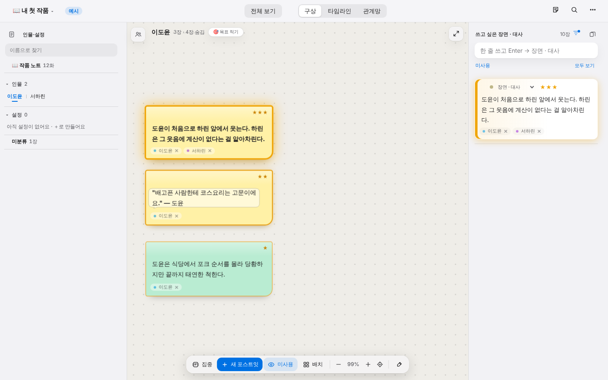
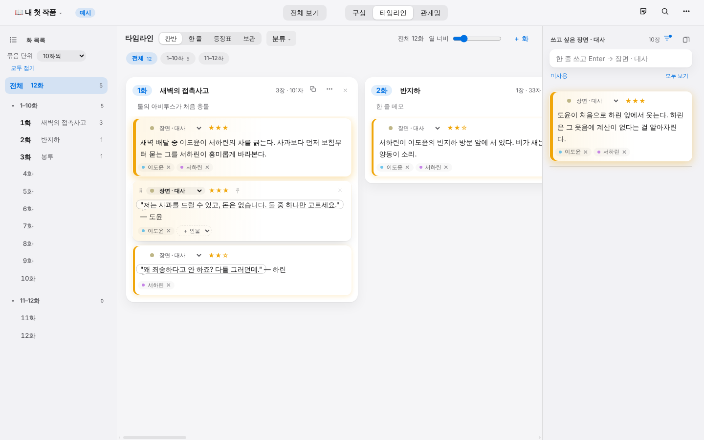
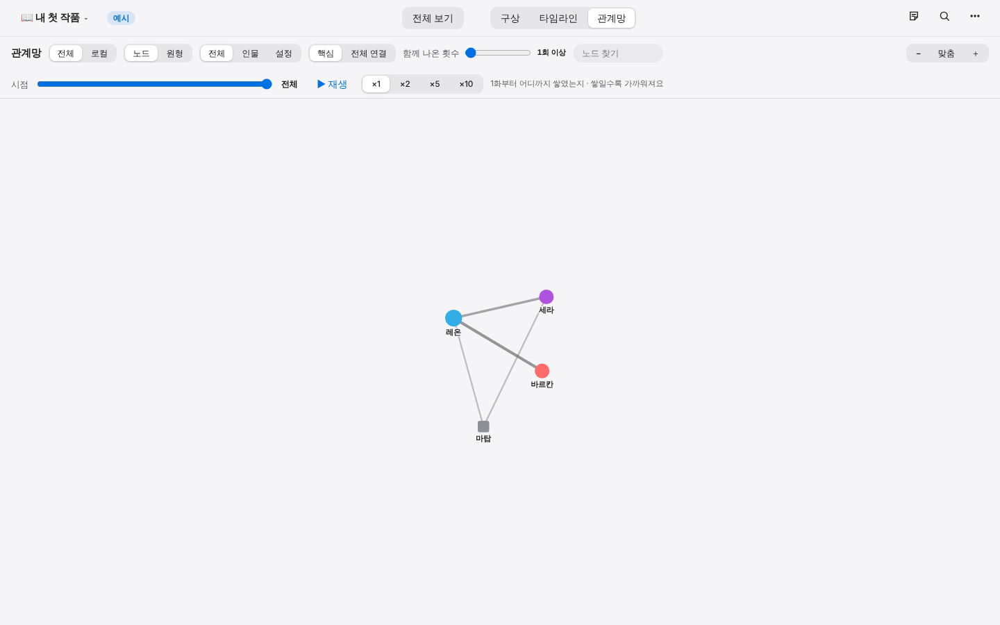
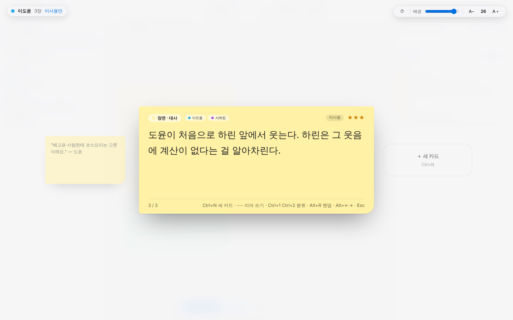
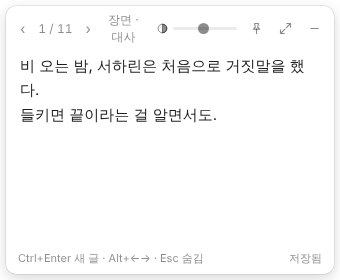
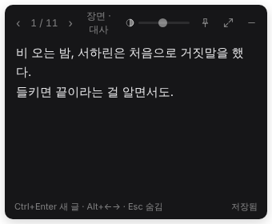

# 캐릭터 스토리라인

> **⬇ 설치 파일 받기** · [Windows (.exe)](../../releases/latest/download/storyline-windows-setup.exe) · [맥 Apple 칩 (.zip)](../../releases/latest/download/storyline-mac-arm64.zip) · [모든 버전](../../releases)
> main 에 새 코드가 들어가면 자동으로 최신 파일로 바뀌어요. 처음 열 때 경고가 뜨면 [아래 설치 안내](#설치)를 봐요.

**글을 쓸 기분이 들게 해 주는, 캐릭터 중심 소설 구상 노트.**
인물마다 코르크보드에 포스트잇을 붙이고, 화별로 늘어놓고, 누가 누구와 얽혀 있는지 한눈에 봐요.
맥과 Windows에서 같이 쓰고, 두 컴퓨터는 GitHub 비공개 저장소로 맞춰요.



---

## 이런 분께

- 떠오르는 장면 · 대사를 일단 어딘가에 붙여 두고 싶은 분
- 인물이 많아져서 "이 사람이 어디서 누구랑 나왔더라"가 헷갈리는 분
- 빈 원고 파일 앞에서 막막해지는 분: 처음 열면 장르별 예시 작품이 있어서 바로 만져 볼 수 있어요

## 주요 기능

### 구상: 인물마다 코르크보드
인물 · 설정마다 자기 보드가 있어요. 포스트잇을 붙이고, 핀을 꽂고, 실로 이어요.
글에 인물 이름이 들어가면 그 인물에 자동으로 연결되고, 오른쪽 목록에는 아직 안 쓴 장면 · 대사가 모여요.

### 타임라인: 화별로 늘어놓기
카드를 화로 끌어다 놓아 이야기 순서를 잡아요. 칸반 · 한 줄 · 인물 등장표 · 보관 칸으로 볼 수 있고,
한 화의 카드를 이어 붙여 원고 글로 복사할 수도 있어요.

**갈래**: 비슷한 장면을 또 썼다면 따로 두지 말고 기존 카드의 갈래로 넣어요. 한 줄 보기에서 **⑂ 갈래**를 켜고 카드를 다른 카드 가운데에 끌어다 놓거나, 카드의 **⑂** 버튼으로 지금 글을 복사해 다르게 써 봐요.
본선 옆에 갈래가 나란히 펼쳐지고, **이걸로**(본선과 자리 바꾸기) · **합치기**(문장을 골라 합친 글을 본선으로) · **↩ 떼어내기**(오른쪽 목록으로 돌려놓기) · **✕**(휴지통)로 정리해요. 원래 본선은 지우지 않고 갈래로 남고, 원고 복사는 본선만 써요.



**새단장 화면** (설정 → 겉모습 → 화면 디자인 → 새단장): 오른쪽에서 가져온 포스트잇이 타임라인에서 하얀 색인 카드로 바뀌어요.
- 칸반은 상자 없는 화 레인과 색인 카드로 훑어보고, 한 줄 보기는 원고 한 장처럼 읽어요 (글 폭 · 글자 크기 조절, 문단을 두 번 누르면 집중).
- 카드에 마우스를 올리면 분류 바꾸기 · ↩ 빼기 · 폐기가 나와요.
- 갈래는 원고에 펼치지 않고 겹친 종이와 **⑂** 표시만 붙어요. **⑂**를 누르면 갈래 지도(양쪽 · 오른쪽 · 아래로 · 둘레)에서 고르고, 안 쓸 갈래는 폐기해도 X로 남아요. ← → Enter Esc 로도 다뤄요.
- 13인치처럼 좁은 창에선 타임라인 화 목록 · 인물 시트가 저절로 접혀요 (직접 열고 닫으면 그대로).

### 관계망: 함께 나온 만큼 가까이
포스트잇에 함께 나온 횟수로 인물 사이를 자동으로 이어요. 시점 슬라이드를 움직이면 1화부터 관계가 어떻게 쌓였는지 재생돼요.



### 집중 모드: 포스트잇 한 장만 크게
화면을 비우고 한 장에만 써요. `---` 를 치면 거기서 카드가 나뉘어 계속 이어 쓸 수 있고, 타이머도 있어요.



### 포스트잇 모드: 작은 창 하나로 조용히
**⌘⌥N** (Windows **Ctrl+Alt+N**) 한 번이면 큰 창이 사라지고 화면 구석에 작은 메모 창만 남아요.

<p>
  
  
</p>

- 테두리 · 메뉴 · 작업 표시줄 아이콘이 없고, 색 없는 종이라 화면에 자연스럽게 묻혀요 (밝은 화면이면 흰색 · 어두운 화면이면 검은색)
- 투명도 슬라이드, 항상 위에 두기
- 쓰는 대로 지금 작품에 카드로 저장. **⌘/Ctrl+Enter** 새 메모 · **Alt+← →** 지난 메모 넘기며 고치기 · **Esc** 숨기기
- 같은 단축키를 다시 누르면 숨어요. 앱이 뒤에 있어도 돼요
- Windows: 숨긴 포스트잇은 알림 영역(시계 옆) 아이콘을 눌러 다시 꺼내요. 작업 표시줄 아이콘 우클릭 → **포스트잇 모드로 열기** 로 큰 창 없이 바로 시작

### 그 밖에
- **자동 저장 · 자동 백업**: 고칠 때마다 저장, 10분마다 압축 백업. 파일이 깨져도 가장 최근의 멀쩡한 사본에서 되살려요
- **작품별 관리**: 작품마다 따로 저장 · 복제 · 보관함(지우지 않고 치워 두기)
- **전체 검색** (⌘F), **되돌리기**, **휴지통**
- **쓰는 손이 편하게**: 둥근 따옴표 · 괄호 자동 닫기 · `...` → `…`, 대사(`""`)와 속마음(`''`)은 말풍선으로 표시
- **겉모습**: 밝은 테마 5 · 어두운 테마 5, 포스트잇 모양 여러 가지, 글꼴 올려 쓰기
- **내보내기**: 타임라인 · 인물 설정을 Markdown 으로, 코르크보드를 PNG 로, 전체를 백업 파일(.json)로

## 설치

맨 위 링크나 **[Releases](../../releases/latest)** 에서 받아요.

| 파일 | 대상 |
|---|---|
| `storyline-windows-setup.exe` | Windows 10 · 11 (x64). 받아서 실행 · 관리자 권한 없이 내 계정에만 설치 |
| `storyline-mac-arm64.zip` | macOS (Apple Silicon). 압축을 풀고 `캐릭터 스토리라인.app` 을 응용 프로그램 폴더로 |

main 에 올라가기 전의 시험판은 **[Actions](../../actions) → `build` → 해당 실행 → Artifacts** 에서 받아요. (GitHub 로그인 필요 · 압축을 한 번 더 풀어야 함)

> 서명하지 않은 앱이라 처음 열 때 경고가 떠요.
> Windows: "Windows의 PC 보호" → **추가 정보 → 실행** · 맥: 앱을 우클릭 → **열기**

### 업데이트

한 번 설치하면 그다음부터는 앱이 알아서 업데이트해요. 설치 파일을 다시 받지 않아도 돼요.

- 켜고 잠시 뒤 · 6시간마다 새 버전이 있는지 보고, 있으면 앱 코드(수백 KB)만 받아 둬요.
- 받아 두면 위쪽에 **"새 버전을 받아 뒀어요 · 지금 다시 시작"** 이 떠요. 다시 켜면 새 버전으로 켜져요.
- 설정 → 데이터 → **앱 업데이트** 에서 지금 버전을 보고 직접 확인할 수도 있어요.
- 새 버전이 제대로 켜지지 않으면 저절로 설치한 버전으로 돌아가요.
- Electron 자체를 올려야 하는 드문 업데이트만 설치 파일을 새로 받으라고 알려 줘요.

## 두 컴퓨터에서 같이 쓰기 (GitHub 동기화)

1. GitHub 에서 원고용 **비공개(Private)** 저장소를 하나 만들어요 (README 포함). 이 코드 저장소와는 따로 두는 걸 권해요.
2. [Fine-grained token](https://github.com/settings/personal-access-tokens/new) 을 만들어요.
   - Repository access: **그 저장소만** · Permissions → Contents: **Read and write** 하나만
3. 앱 → 설정 → 데이터 → **GitHub 동기화 → 연결하기** 에 `아이디/저장소이름` 과 토큰을 넣어요. 두 컴퓨터 모두.

앱을 켤 때 · 창으로 돌아올 때 · 고친 뒤 30초쯤 · 5분마다 · 끌 때 저절로 맞춰요.
양쪽에서 같은 작품을 고쳤다면 이 컴퓨터 것은 그대로 두고, 다른 컴퓨터 것은 **"작품 이름 (다른 기기 날짜)"** 사본으로 남겨요. 지워지는 건 없어요.
토큰은 그 컴퓨터 안에만, OS 열쇠고리(맥 키체인 · Windows 자격 증명)로 암호화해서 보관해요.

## 단축키

| 하는 일 | 맥 | Windows |
|---|---|---|
| 포스트잇 모드 꺼내기 · 숨기기 | ⌘⌥N | Ctrl+Alt+N |
| 새 포스트잇 | ⌘N | Ctrl+N |
| 분류별 새 포스트잇 | ⌘1 · ⌘2 … | Ctrl+1 · Ctrl+2 … |
| 집중 모드 | ⌥Z | Alt+Z |
| 전체 화면 (보드만) | ⌘. | Ctrl+. |
| 전체 검색 | ⌘F | Ctrl+F |
| 되돌리기 · 다시 하기 | ⌘Z · ⌘⇧Z | Ctrl+Z · Ctrl+Shift+Z |
| 설정 | ⌘, | Ctrl+, |
| 도움말 | ? | ? |

전체 목록은 앱의 도움말(?) → 단축키 탭에 있어요.

## 데이터는 어디에

| | 맥 | Windows |
|---|---|---|
| 작품 | `iCloud Drive/캐릭터 스토리라인/` (iCloud 가 없으면 `~/Documents/캐릭터 스토리라인/`) | `문서\캐릭터 스토리라인\` |
| 로컬 사본 | `~/Library/Application Support/캐릭터 스토리라인/data/` | `%APPDATA%\캐릭터 스토리라인\data\` |

작품마다 `works/<작품>/` 폴더에 데이터와 백업이 있어요. 앱을 지우거나 새 버전으로 바꿔도 그대로예요.

## 개발

```bash
cd storyline-app
npm install
npm start      # 앱 실행
npm test       # 저장소 · 동기화 테스트
```

- Electron 앱이에요. 화면 코드는 `src/`, 저장소는 `storage/`, 포스트잇 창은 `note/`
- 폴더 구성 · 코드 규칙 · 맥에서 앱 직접 만들기는 [`storyline-app/README.md`](storyline-app/README.md)
- `main` 에 올리면 GitHub Actions 가 테스트하고 Windows · 맥 앱을 만들어요
